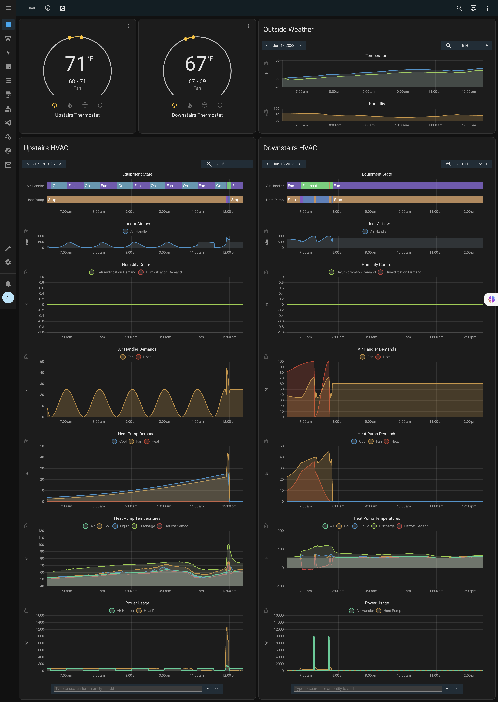

# Daikin One for Home Assistant

 

A custom component for Home Assistant to integrate with Daikin One+ smart HVAC systems. This integration allows you to control your thermostats and view all the telemetry reported by your equipment.

- [Daikin One for Home Assistant](#daikin-one-for-home-assistant)
  - [Features](#features)
  - [Todo](#todo)
  - [Supported Equipment](#supported-equipment)
    - [Thermostats](#thermostats)
    - [Air Handlers & Indoor Units](#air-handlers--indoor-units)
    - [Heat Pumps & Outdoor Units](#heat-pumps--outdoor-units)
    - [Air Conditioners](#air-conditioners)
    - [Furnaces](#furnaces)
    - [Coils & System Accessories](#coils--system-accessories)
  - [Installation](#installation)
    - [Install via HACS](#install-via-hacs)
    - [Manual Install](#manual-install)

## Features

- Controllable climate entities for each thermostat
- All HVAC modes supported by the Daikin One+ system, including Emergency Heat
- Intelligent handling of thermostat updates for ultra-fast response times
- Sensors for status, temperatures, airflow, demand, etc. for all connected equipment
- Outdoor and indoor air quality sensors (if reported by your system)

<!-- markdownlint-disable-next-line no-inline-html -->

Dashboard source can be found [here](docs/dashboard.yaml) if you'd like you use it as a starting point for your own dashboard.

## Todo

- Weather entities for each thermostat
- Support for additional equipment types

## Supported Equipment

The following is the list of currently confirmed working equipment reported by users and tested with the integration.

If you have a Daikin One+ system (or compatible communicating Amana/Goodman system) and your equipment is not listed here, please open an issue and we can work on adding support. Your raw Daikin API data can be retrieved by clicking "Download Diagnostics" on a thermostat's device page in Home Assistant. That information will be required to add support for your equipment.

### Thermostats

- [One+ Smart Thermostat](https://daikincomfort.com/products/thermostats-controls/daikin-one-plus) (`DTST-CW-A-A` / `ONEPLUS`)
- [One Touch Smart Thermostat](https://daikincomfort.com/products/thermostats-controls/daikin-one-touch) (`DTST-TOU-A-A`)
- [One Lite Smart Thermostat](https://daikincomfort.com/products/thermostats-controls/daikin-one-lite) (`ONELITE_24V` / `D2271`)
- Amana Smart Thermostat (`ATST-CWE-BL-A`)

### Air Handlers & Indoor Units

- [MBVC Modular Blower](https://daikincomfort.com/products/heating-cooling/whole-house/air-handlers-coils/mbvc-modular)
- [DFVE Variable-Speed Air Handler](https://daikincomfort.com/products/heating-cooling/whole-house/air-handlers-coils/dfve) (e.g. `DFVE60DP1300A`)
- [FDMQ Concealed Slim-Duct Units](https://daikincomfort.com/products/heating-cooling/single-zone-ductless/multi-zone/fdmq-indoor-unit) (e.g. `FDMQ12WVJU9`, `FDMQ18RVJU`, `FDMQ24WVJU9`)
- FTWR Series Ductless Mini-Split Indoor Units
- FTQ Series SkyAir Multi-Position Air Handlers (e.g. `FTQ24TAVJUA`, `FTQ42TAVJUA`)

### Heat Pumps & Outdoor Units

- [DZ9VC](https://daikincomfort.com/products/heating-cooling/whole-house/heat-pump/dz9vc)
- [DZ6VS](https://daikincomfort.com/products/heating-cooling/whole-house/heat-pump/daikin-fit-heat-pump-dz6vs)
- [DZ17VSA](https://daikincomfort.com/products/heating-cooling/whole-house/heat-pump/daikin-fit-heat-pump)
- [DH7VS / DH7VSA](https://daikincomfort.com/products/heating-cooling/whole-house/heat-pump/daikin-fit-heat-pump) (e.g. `DH7VSA4810`, `DH7VSA6010A`)
- 4MXL Multi-Zone Outdoor Inverter Heat Pump (e.g. `4MXL36TVJU`)
- RZQ SkyAir Outdoor Inverter Heat Pumps (e.g. `RZQ24TAVJUA`, `RZQ42TAVJUA`)
- Amana ASZS6 Series Variable-Speed Inverter Heat Pump (e.g. `ASZS603610`)
- Goodman GSXC16 Series Communicating Inverter Heat Pump / AC (e.g. `GSXC160481CC`)

### Air Conditioners

- [DX6VS](https://daikincomfort.com/products/heating-cooling/whole-house/air-conditioner/daikin-fit-dx6vs)
- [DX17VS / DX17VSS](https://daikincomfort.com/products/heating-cooling/whole-house/air-conditioner/daikin-fit-dx17vs) (e.g. `DX17VSS241BA`, `DX17VSS601AA`)

### Furnaces

- [DM97MC Modulating Gas Furnace](https://daikincomfort.com/products/heating-cooling/whole-house/gas-furnaces/dm97mc)
- [DM80VC Variable-Speed Gas Furnace](https://daikincomfort.com/products/heating-cooling/whole-house/gas-furnaces/dm80vc)
- [DR96TC Two-Stage Variable-Speed Gas Furnace](https://daikincomfort.com/products/heating-cooling/whole-house/gas-furnaces/dr96tc) (e.g. `DR96TC0804CNAB`, `DR96TC1005CNAA`)
- Amana AMVM97 Modulating Gas Furnace (e.g. `AMVM970803BNBD`)
- Goodman GMVM97 Modulating Gas Furnace

### Coils & System Accessories

- Communicating Electronic Expansion Valve (EEV) Coils (e.g. `CAPEA`, `CHPE`, `2301AC01-05`)
- Daikin One Home Air Monitor (Haven Indoor Air Quality Monitor)
- EWC Controls UT-3000 Communicating Zone Control Board

## Installation

### Install via HACS

_HACS must be [installed](https://hacs.xyz/docs/installation/prerequisites) before following these steps._

1. Log into your Home Assistant instance and open HACS via the sidebar on the left.
2. In the HACS console, open **Integrations**.
3. On the integrations page, select the "vertical dots" icon in the top-right corner, and select **Custom repositories**.
4. Paste `https://github.com/zlangbert/ha-daikinone` into the **Add custom repository URL** box and select **Integration** in the **Category** menu.
5. Select **Add**.
6. Restart Home Assistant
7. Click the below button to add the integration and start setup

### Manual Install

_A manual installation is more risky than installation via HACS. You must be familiar with how to SSH into Home Assistant and working in the Linux shell to perform these steps._

1. Download or clone this repository
2. Copy the `custom_components/daikinone` folder from the repository to your Home Assistant `custom_components` folder
3. Restart Home Assistant
4. Click the below button to add the integration and start setup

